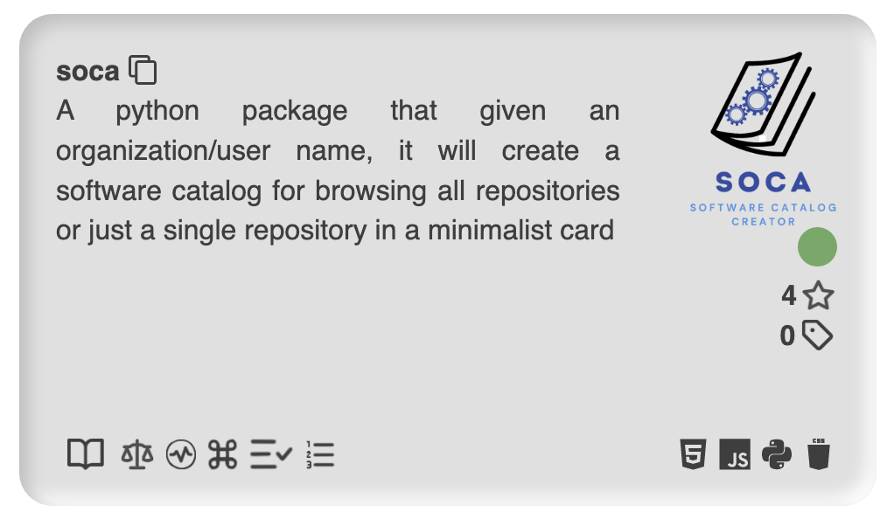

# Software Catalog Creator (soca)

[](https://doi.org/10.5281/zenodo.10316197) [](https://badge.fury.io/py/soca) [](https://www.repostatus.org/#active)


A python package that given an organization/user name, it will create a software catalog for browsing all repositories or just a single repository in a minimalist card.

## Sample result

Click [here](https://oeg-upm.github.io/soca/example/portal_example/index.html) to see an interactive example generated from the current `portal_example` repository list.  

Command used:  

```bash
soca extract -i tmp/repositories/portal_example.csv -o tmp/metadata/portal_example
soca portal -i tmp/metadata/portal_example -o example/portal_example -t "SOCA Portal Example"
```

This is an example of a single card using the command:  

```bash
soca card -i https://github.com/oeg-upm/soca --png
```



## Requirements

* Git
* Python 3.11 or 3.12
* Poetry, optional but recommended for local development

## Install from GitHub

```bash
git clone https://github.com/oeg-upm/soca
cd soca
pip install -e .
```

For local development with Poetry, create the virtual environment and install SOCA from the repository root:

```bash
poetry env use python3.11
poetry install
poetry run somef configure
```

After that, prefix SOCA commands with `poetry run`, for example:

```bash
poetry run soca --help
poetry run soca portal -i tmp/metadata/portal_example -o example/portal_example
```

Highly recommended steps:  

```bash
somef configure
```
Alternatively you may run the _installer.sh_ file which will also configure SOMEF, just edit it to it for your needs.

And you will be asked to provide the following:

* A GitHub authentication token [**optional, leave blank if not used**], which SOMEF uses to retrieve metadata from GitHub. If you don't include an authentication token, you can still use SOMEF. However, you may be limited to a series of requests per hour. For more information, see [https://help.github.com/en/github/authenticating-to-github/creating-a-personal-access-token-for-the-command-line](https://help.github.com/en/github/authenticating-to-github/creating-a-personal-access-token-for-the-command-line)

* The path to the trained classifiers (pickle files). If you have your own classifiers, you can provide them here. Otherwise, you can leave it blank

## Usage

```text
Usage: soca [OPTIONS] COMMAND [ARGS]...

  SOCA (Software Catalog Creator)

  Automatically generates a searchable portal for every repository of an
  organization/s or user/s, which is easy to host.

  Usage:
  
  =. (Configure) Create configuration file for SOCA/SOMEF
  1. (fetch) Fetch all repos from the desired organization/s
  2. (extract) Extract all metadata for every repo
  3. (portal) Generate a searchable portal for all the retrieved data
  4. (summary) Create a summary from the portal information

Options:
  -h, --help  Show this message and exit.

Commands:
  card               Create a stand-alone card ready to be embedded in a website
  configure          This creates a ~/.soca/configure.ini file
  extract            Fetch and save metadata from introduced repos
  extract-1-repo     Fetch and save metadata from introduced repo
  fetch              Retrieve all organization/s or user/s repositories
  linkeddata-portal  Generate LinkedData.es HTML pages and copy static assets
  portal             Build a portal with a minimalist design
  summary            Create a summary of good practices from portal card data
```

In order to use SOCA you will need to follow the next steps:  

### 1 - Fetch

First thing to do is gather all repositories pointers that we want to use. We'll use the `fetch` command to ease this task.

```text
  -i, --input <name-or-path>  Organization or user name  [required]
  -o, --output <path>         Repository list output file  [default: repos]
  --org                       Extracting from a organization  [default: True]
  --user                      Extracting from a user  [default: False]
  -na, --not_archived         Fetch only repos that are not archived
                              [default: False]
  -nf, --not_forked           Fetch only repos that are not forked  [default:
                              False]
  -nd, --not_disabled         Fetch only repos that are not disabled
                              [default: False]
  -h, --help                  Show this message and exit.
```

Is important to determine if the name belongs to a user or a organization by using the --user or --org flag, additionally you can specify an output path with the flag -o.

Example:  

`soca fetch -i dakixr --user`  
`soca fetch -i oeg-upm --org -o oeg-upm_repos --not_archived`  

This command also accepts a file as input (names separated by a new-line) for ingesting multiple names at a time.  

Example:  
`soca fetch -i multiple-users.csv --user -o multiple-users_repos`  
`soca fetch -i multiple-orgs.csv --org -o multiple-orgs_repos --not_archived`  

The output of this command is a csv file with all the repos of the selected users/orgs.
At this moment is a good time to clean this file (remove all repos that you don't want to use).
Note: you can add manually any other repository.

### 2 - Extract

Then we use the `extract` command to extract all the metadata required from each repository. If you want a more in-depth analysis on Python repositories use the flag -i4p or --inspect4py.

```text
  -i, --input <csv-repos>  Pointers to the repositories in csv format
                           [required]
  -o, --output <path>      Dir where repositories metadata will be saved
  -i4p, --inspect4py       Use inspect4py to extract additional metadata from
                           Python repositories
  -h, --help               Show this message and exit.
```

Example:  
`soca extract -i tmp/repositories/portal_example.csv -o tmp/metadata/portal_example`

### 2b - Extract one repository

Use `extract-1-repo` when you want to create metadata for a single GitHub repository without preparing a CSV file first.

```text
  -i, --input <URL>    GitHub repo URL  [required]
  -o, --output <path>  Dir where repositories metadata will be saved
  -v, --verbose        Fetch only repos that are not archived
  -h, --help           Show this message and exit.
```

Example:

`soca extract-1-repo -i https://github.com/oeg-upm/soca -o soca_metadata`

### 3 - Portal

This is the last step in the pipeline. For building the portal we need to use the command `portal`, it will take as input the directory created by the command extract.

```text
  -i, --input <dir-json-metadata>
                                  Dir repositories metadata in json format
                                  [required]
  -o, --output <path>             Dir where Software Catalog Portal will be
                                  saved  [default: portal]
  -t, --title <title>             Portal's title  [default: Software Catalog]
  -fi, --favicon <path-icon.ico>  Portal's favicon  [default: img/soca-
                                  logo.ico]
  -h, --help                      Show this message and exit.
```

Example:  
`soca portal -i tmp/metadata/portal_example -o example/portal_example --title "SOCA Portal Example"`

If everything worked fine now a new dir should have been created with all the assets and code to deploy this portal.

#### DashVERSE dashboard links

The classic SOCA portal can include links to local DashVERSE/Superset dashboards. When `soca portal` runs, it creates `dashboard-org.html` and `dashboard-repo.html` in the portal output directory and links them from the portal header.

Configure these environment variables before generating the portal:

```bash
export SUPERSET_PUBLIC_DOMAIN="http://localhost:8088"
export DASHBOARD_ORG_EMBED_ID="<organization-dashboard-id-or-url>"
export DASHBOARD_REPO_EMBED_ID="<repository-dashboard-id-or-url>"
soca portal -i tmp/metadata/portal_example -o example/portal_example -t "SOCA Portal Example"
```

On PowerShell, set the same variables with `$env:SUPERSET_PUBLIC_DOMAIN`, `$env:DASHBOARD_ORG_EMBED_ID` and `$env:DASHBOARD_REPO_EMBED_ID`.

`SUPERSET_PUBLIC_DOMAIN` must be the Superset URL reachable from the browser that opens the portal. The dashboard variables can contain a Superset dashboard id or a full dashboard URL; SOCA appends `standalone=2` for the embedded view.

This README does not cover deploying DashVERSE itself. For local deployment, dashboard imports and Superset setup, see the [DashVERSE developer and deployment documentation](https://github.com/EVERSE-ResearchSoftware/DashVERSE/blob/main/docs/README.dev.md).

### LinkedData portal

SOCA can also generate the LinkedData.es static pages from a YAML configuration and an optional list of GitHub tools. The tools file must contain a `tools` list of GitHub repository URLs:

```yaml
tools:
  - https://github.com/oeg-upm/soca
  - https://github.com/oeg-upm/rsfc
```

The command can reuse SOCA metadata already extracted by `soca extract` or `soca extract-1-repo`. Missing tool metadata is extracted automatically into the LinkedData metadata cache.

```text
  --config FILE                   Path to linkeddata.base.yml.
  --templates-dir DIRECTORY       Directory containing Jinja templates.
  --assets-dir DIRECTORY          Directory containing static assets.
  --output-dir DIRECTORY          Directory where generated HTML will be written.
  --metadata-dir DIRECTORY        Directory containing project SOCA metadata JSON files.
  --linkeddata-metadata-dir DIRECTORY
                                  Directory where LinkedData portal metadata cache will be saved.
  --generated-config-output FILE  Path where the resolved LinkedData YAML config will be written.
  --tools-file FILE               YAML file with a tools list of GitHub repository URLs.
  -h, --help                      Show this message and exit.
```

Example using the current example metadata and tools file:

```bash
soca linkeddata-portal \
  --tools-file example/linkeddata_portal/linkeddata_tools.yml \
  --metadata-dir tmp/metadata/portal_example \
  --linkeddata-metadata-dir tmp/metadata/linkeddata_portal_cache \
  --output-dir example/linkeddata_portal/site \
  --generated-config-output example/linkeddata_portal/linkeddata.generated.yml
```

Keep the tools file outside the output directory. The LinkedData builder resets `--output-dir` before writing the generated site.

### Summary
SOCA now allows to produce a summary json of a given cards_data.json created by the previous portal step.
For building the summary we need to use the command `summary`
```
  -i, --input <dir-json-metadata>
                                  Dir repositories metadata in json format
                                  [required]
  -o, --output <path>             Dir where Software Catalog Portal will be
                                  saved  [default: summary]
```
Example
`soca summary -i example/portal_example/cards_data.json -o tmp/summary/portal_example`

### Create a stand-alone card

SOCA also gives the option to create a single card in one of two different formats:

* HTML
* PNG

```text
  -i, --input <url>    Repository URL  [required]
  -o, --output <path>  Output file where the html will be saved  [default:
                       card]
  --html               Save card as html  [default: True]
  --png                Save card as a png  [default: False]
  -h, --help           Show this message and exit.
```

As input you will need a github repository url and use one of the flags: --html or --png.  
Note: if no flag is used the default is html.  

Example:  
`soca card -i https://github.com/oeg-upm/soca --html`  
`soca card -i https://github.com/oeg-upm/soca --png`

### Styling the portal

In case you want to change the default style of the portal, SOCA decouples the .css files from the code-base. So in the resulting portal directory there will be two .css files are available for further tinkering and styling to everyone needs.

